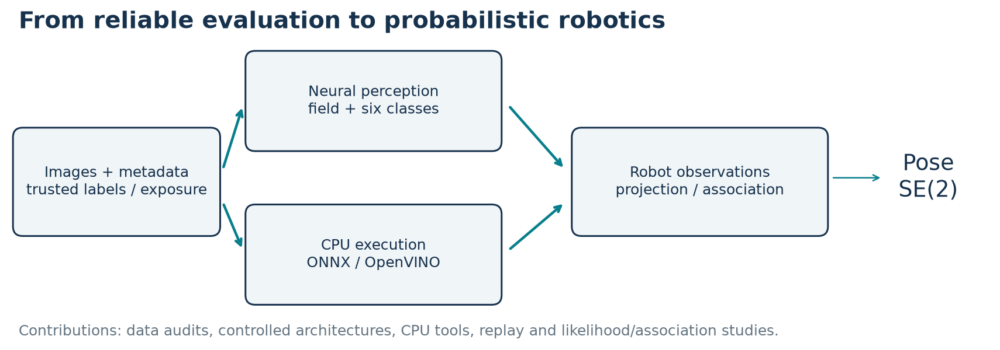
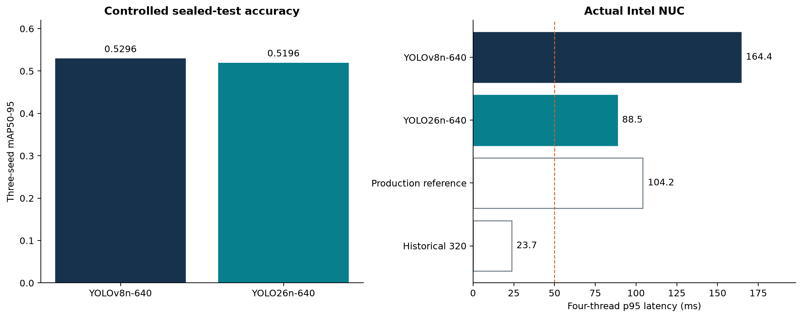
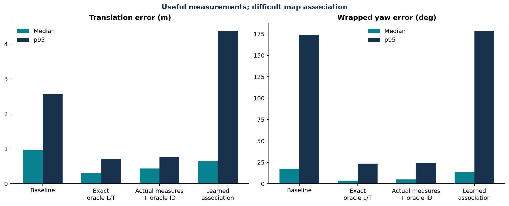

# RoboCup Humanoid Perception

**Vision, efficient inference and probabilistic localization**

A humanoid football robot must recognize a small moving ball, distinguish field
from clutter, and use repeated field markings to estimate its position. It must
do this while its camera moves and its onboard CPU also runs the rest of the
robot. This project investigates the complete chain from trustworthy labels to
neural perception, CPU inference and pose-level validation.

I am **Yacine Zahouani**, an ENSEIRB-MATMECA engineering student. I developed this
research programme with **ITA-ITAndroids**, supervised by **Marcos Maximo**. My
contributions include annotation correction and evaluation design, controlled
model studies, selective-sharing architectures, deployment tools, deterministic
simulation, probabilistic localization experiments and a focused C++ correction.
The robot, team software and established model families are upstream work.

[Current system and evidence](docs/system-and-evidence.md) ·
[Technical reports](docs/reports/index.md) ·
[Source map](#source-map) ·
[Model contracts](docs/model-cards/README.md) ·
[Engineering handoff](docs/handoff/README.md) ·
[Releases](https://github.com/yacinezah/robocup-humanoid-perception/releases)

**Data release:** [TORSO-21 reviewed field-line masks](https://github.com/yacinezah/torso21-reviewed-field-lines/releases/tag/v0.1.0) — 2,400 reviewed masks, source mappings, and reproducible change analysis.



## Selected results

**Current reference (4 October 2026):** buffered rectangular detection +
S-compact field/line segmentation + sparse32. See the
[final reference table](docs/system-and-evidence.md#final-reference-table) for
separate quality, CPU, localization and multitask decisions. Earlier reports
remain historical authorities for their own protocols.

| Contribution | Result | Evidence |
|---|---|---|
| Detector geometry debugging | Correct source restoration improves mAP50–95 **0.706104 → 0.744006**, unchanged weights/input | DET-R1 reused open development; production exposure unknown |
| Complete CPU perception | Buffered rectangle + compact + sparse32 **51.105 → 46.993 ms**, **8.05%** lower p95 | DEP-R1 AC laptop, four P-core primaries; median of three repetition p95s; modest gain, below frozen 10% target |
| Trustworthy field/line supervision | Sequence grouping, corrected labels and **2,400 human-reviewed masks**; quality and compact references remain distinct | SEG-R1 exposed development; all-mask refit has no independent accuracy estimate |
| Controlled six-class detection | **12,018 images, three seeds**; YOLOv8n mAP50-95 **0.5296**, YOLO26n **0.5196** | Same-data sealed test |
| Actual target-CPU measurement | YOLO26 had **46% lower four-thread p95** latency than YOLOv8; Fast-SCNN field inference **13.079 ms p95** | Intel NUC, measured separately by study |
| Sharing isolated from compression | Only **2.04%** convolution MACs saved by sharing versus matched compact separate; line quality not preserved | MTL-R2 negative causal result; MTL-R3/R3.1 stopped before training |
| Pose-level validation | Sparse32 supports tracking; final reset recovery only **7/18** | LOC-R6 same-world simulation; no robust global recovery or real-robot pose claim |
| Probabilistic software debugging | Corrected neutral likelihood gating that let incompatible hypotheses outrank compatible ones | C++ tests, Gazebo and real-Chape runtime regression |

Accuracy and latency are not one universal leaderboard. Historical 640-pixel
detectors exceeded a 50 ms NUC p95 target; the latest laptop result is not NUC
evidence or whole-robot timing. Later explicit-line multitask work did not
establish a specialist-preserving shared Pareto point. Strict raw export parity
limitations remain. The deployed perception stack was not replaced.

## Research contributions

### Reliable evaluation before model selection

Manual mask correction and trusted supervision made line/field evaluation
meaningful. Sequence and duplicate audits found **54 and 66 overlapping groups
in two different historical splits**. Deterministic preprocessing, exposure
ledgers and frozen protocols replaced misleading comparisons.

### Neural architecture and CPU tradeoffs

Separate field specialists establish quality and speed references. A controlled
YOLOv8n/YOLO26n study separates architecture effects from data and seed effects.
The multitask investigation progresses from supervision scale to a private
field-semantic hierarchy, with frozen-sharing, joint-training and distillation
controls. Later matched compact controls distinguish decoder compression from
sharing. CPU feasibility gates stopped the final proposed architecture before
training; the measurement follow-up ended unresolved.



### Perception tested through robot behavior

A deterministic **16-scenario, 2,250-frame ROS/Gazebo benchmark** exposes geometry
and temporal behavior. Field-context ball reranking improved designed stress
cases but regressed on untouched replay, so it was not promoted. Localization
experiments separate landmark utility, measurement noise, map identity and
likelihood semantics. Later sensor/line studies improve typical tracking while
exposing tail errors, map consistency and symmetric-field ambiguity.



## Try it

### Dataset-free CPU checks

```bash
python -m venv .venv
# Activate the environment for your shell, then:
python -m pip install -e ".[test,runtime]"
python -m pytest
python examples/synthetic_smoke.py
```

The smoke example uses artificial geometry and observations. It does not train,
download weights, contact a robot or access private evaluation images. Neural
unit tests additionally require the versions listed in the environment guide.

### Inference on your own image

The useful current system is the separate detector/field/line stack. Its
production-derived model binaries are available only through a separately
authorized ITAndroids handoff, **not in the public release**. With the pinned
rectangle and S-compact XML/BIN pairs:

```bash
perception-separate --detector artifacts/detector-rectangular/model.xml \
  --segmenter artifacts/segmenter-compact/model.xml \
  --profile rect_compact_buffered --image my-frame.jpg --output prediction.json
```

This verifies both files of each graph before inference and writes
source-coordinate detections, at most 32 line-support pixels, and three native
dense probability maps. No automatic downloads or robot connection occur.
See [exact contracts and run instructions](docs/reproducibility.md#current-separate-stack).
Public synthetic tests work without these binaries. Historical raw-head
multitask inference remains available as `perception-infer`; it uses a different
model/decoder contract and is a research prototype.

For a new CPU measurement, `perception-benchmark --help` exposes explicit
thread, stream and power-state settings. Its synthetic-input model-only timing
is not a reproduction of historical complete-call timings.

## Source map

| Area | Implementation | Start here |
|---|---|---|
| Data and metrics | [Exposure grouping, bootstrap and metrics](src/robocup_perception/data/) | [Evaluation rules](docs/methods/data-and-evaluation.md) |
| Segmentation | [Inherited MIT model/training code](src/soccer_segmentation/) | [Field/line study](docs/reports/three-class-field-and-line-segmentation.md) |
| Detection | [Raw-head decoding](src/robocup_perception/detection/) | [Controlled comparison](docs/reports/controlled-yolov8n-yolo26n-comparison.md) |
| Multitask | [Models, losses, data masking and trainers](src/robocup_perception/multitask/) | [Architecture and contract](docs/methods/multitask-contract.md) |
| Current separate inference | [Hash-checked CPU runtime](src/robocup_perception/runtime/separate.py) and [sparse32](src/robocup_perception/localization/sparse_support.py) | [System and evidence](docs/system-and-evidence.md) |
| Historical export and timing | [ONNX/OpenVINO export, parity and timing](src/robocup_perception/runtime/) | [Reproducibility](docs/reproducibility.md) |
| Ball selection | [Field-contact features and scoring](src/robocup_perception/ball_selection/) | [Generalization result](docs/reports/field-context-ball-selection.md) |
| ROS/Gazebo | [Scenarios, capture, replay and patches](simulation/) | [Simulation dependencies](simulation/README.md) |
| Localization | [Association, sensor assumptions and lines](src/robocup_perception/localization/) | [Observability audit](docs/reports/map-observability-and-symmetry.md) |
| C++ repair | [Exact patch and component test](patches/observation-likelihood/) | [Review and rollback](docs/handoff/localizer-review.md) |

## Reports and reproducibility

[Sixteen technical reports](docs/reports/index.md) contain methods, authoritative
tables, qualifications and implementation links. They are authored project
reports, not peer-reviewed publications. The [ENSEIRB reference map](reproducibility/enseirb-references.json)
links references [6]-[21] to stable professional documents. Frozen results have
not been re-evaluated for publication.

The [reproducibility guide](docs/reproducibility.md) distinguishes public smoke
tests, user-image inference and scientific reproduction requiring separately
licensed data. Git contains source, synthetic tests, small aggregate tables and
figures. Releases contain selected artifacts and manifests. Datasets, protected
frame identities, raw captures and optimizer states are excluded.

## Handoff and next steps

The [handoff guide](docs/handoff/README.md) separates research prototypes from
reviewable software. The C++ likelihood patch is isolated from experimental
association. Neither the patch nor a new neural stack is represented as merged
into production.

The next integration decisions require an independent real-robot accuracy/pose
corpus, an agreed end-to-end timing budget and robust association under field
symmetry. The present repository provides the code and evidence needed to make
those decisions without repeating invalid comparisons.

## Citation, licence and acknowledgements

Use [CITATION.cff](CITATION.cff) and the immutable release commit when citing this
edition. Original utilities use MIT, original reports/figures/tables CC BY 4.0,
and inherited components retain their own terms. See [LICENSE](LICENSE) and
[third-party notices](THIRD_PARTY_NOTICES.md), especially for Ultralytics-derived
code and model obligations.

Thanks to Marcos Maximo and ITAndroids for supervision, robot infrastructure and
collaboration, and to the maintainers of the open-source frameworks used here.
